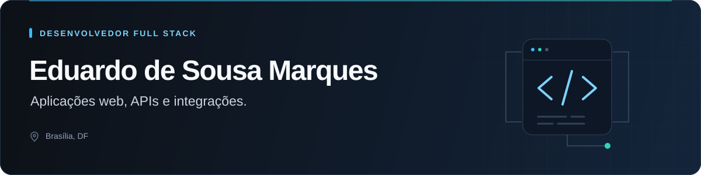
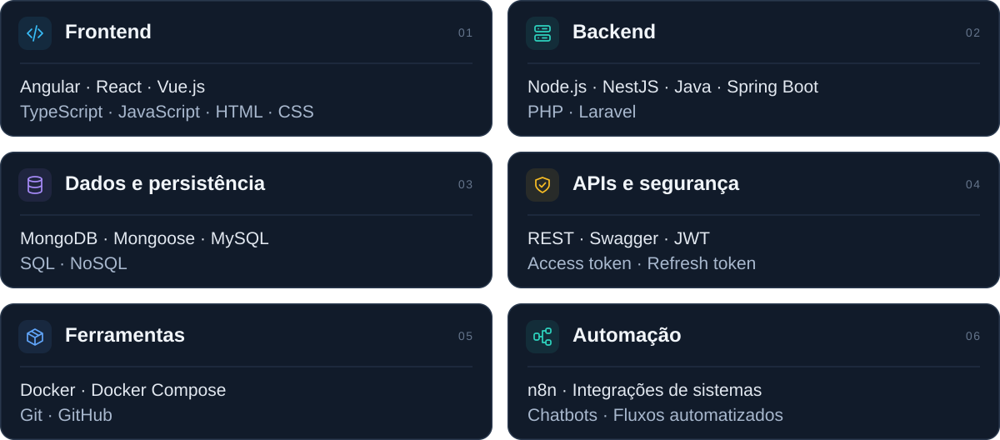
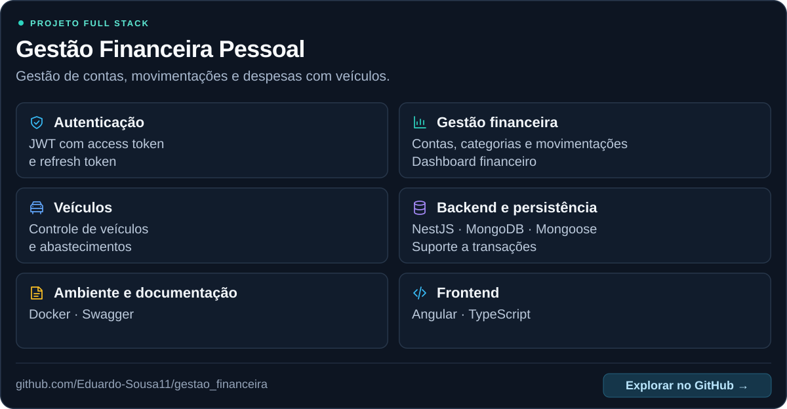
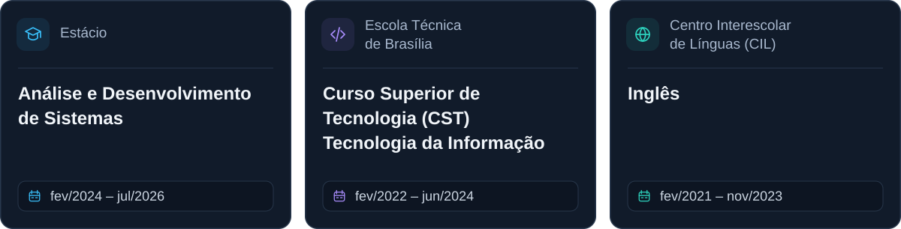

  

  
  
  

  
  
  
  
  

## Sobre mim

Sou **Eduardo de Sousa Marques**, desenvolvedor Full Stack em **Brasília, DF**, com experiência na criação e evolução de aplicações web, APIs REST e integrações de sistemas.

Atuo do frontend ao backend, trabalhando com interfaces responsivas, autenticação, bancos de dados SQL e NoSQL e automação de processos. Meu foco é construir soluções com **código organizado, performance e escalabilidade**.

## Tecnologias

<picture>
  <source media="(max-width: 700px)" srcset="./assets/tecnologias-mobile.svg" />
  
</picture>

- **Frontend:** Angular, React, Vue.js, TypeScript, JavaScript, HTML e CSS.
- **Backend:** Node.js, NestJS, Java, Spring Boot, PHP e Laravel.
- **Dados e persistência:** MongoDB, Mongoose e MySQL; SQL e NoSQL.
- **APIs e segurança:** REST, Swagger, JWT, access token e refresh token.
- **Ferramentas:** Docker, Docker Compose, Git e GitHub.
- **Automação:** n8n, integrações de sistemas, chatbots e fluxos automatizados.

## Projeto em destaque

<a href="https://github.com/Eduardo-Sousa11/gestao_financeira">
  <picture>
    <source media="(max-width: 700px)" srcset="./assets/gestao-financeira-mobile.svg" />
    
  </picture>
</a>

### Gestão Financeira Pessoal

Aplicação Full Stack para gestão de finanças pessoais, com acompanhamento de contas, movimentações e despesas com veículos.

- **Autenticação:** JWT com access token e refresh token.
- **Gestão financeira:** contas, categorias, movimentações e dashboard financeiro.
- **Veículos:** controle de veículos e abastecimentos.
- **Backend e persistência:** NestJS, MongoDB e Mongoose, com suporte a transações.
- **Ambiente e documentação:** Docker e Swagger.
- **Frontend:** Angular e TypeScript.

**Stack:** `Angular` `NestJS` `TypeScript` `MongoDB` `Mongoose` `JWT` `Docker` `Swagger`

## Experiência profissional

### RIUS Soluções Tecnológicas

**Desenvolvedor Web** · out/2025 – atual · Distrito Federal

- Desenvolvimento e manutenção de aplicações com **React, Vue.js, Angular e Node.js**.
- Implementação de funcionalidades frontend e backend e integração de APIs, participando de todo o ciclo de desenvolvimento.

### Manda Receita Consultoria Magistral

**Desenvolvedor Web** · abr/2025 – out/2025 · Goiânia, GO

- Criação e manutenção de funcionalidades em **PHP, JavaScript e MySQL**.
- Integrações e otimizações de banco de dados, com foco em performance, estabilidade e usabilidade.

### DF Informática — Criação de Sites

**Desenvolvedor Web** · set/2023 – abr/2025 · Brasília, DF

- Desenvolvimento Full Stack com **PHP, JavaScript, MySQL, Node.js, Laravel e React**.
- Criação de interfaces responsivas, evolução de sistemas e modelagem e otimização de bancos de dados.

## Formação

<picture>
  <source media="(max-width: 700px)" srcset="./assets/formacao-mobile.svg" />
  
</picture>

Consultar formação em texto

- **Análise e Desenvolvimento de Sistemas — Estácio:** fev/2024 – jul/2026.
- **Curso Superior de Tecnologia (CST) — Tecnologia da Informação — Escola Técnica de Brasília:** fev/2022 – jun/2024.
- **Inglês — Centro Interescolar de Línguas (CIL):** fev/2021 – nov/2023.

## Contato

Para conversar sobre desenvolvimento e projetos, entre em contato pelo [LinkedIn](https://www.linkedin.com/in/eduardo-sousa-291b362a4/) ou pelo e-mail **[dudumarques.510@gmail.com](mailto:dudumarques.510@gmail.com)**.
